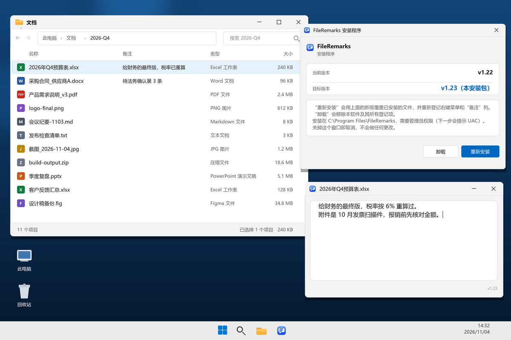

# FileRemarks

**在资源管理器里给任意文件加一列备注。**

不用建索引、不用开数据库：文件列表里多一列“备注”，右键或 `Shift+F2` 就能写，备注跟着文件本身走。

Windows 10 / 11 · 当前版本 **v1.23** · 仅 NTFS 分区

## 核心能力

- **资源管理器原生“备注”列**：安装后自动追加到通用文件夹、文档、图片、下载、音乐、视频六类默认视图，不必手动添加列。
- **备注跟着文件走**：普通文件写进 NTFS 备用数据流（ADS）`:remark`，重命名、同盘移动后仍在；Office 文档额外写入文件属性，跨盘复制也能带走。
- **右键或快捷键直达**：文件右键“编辑备注”，或选中单个文件按 `Shift+F2`，弹出备注编辑窗。
- **没有保存按钮**：关窗、切到别的窗口或按 `Ctrl+Enter` 都会自动保存，保存后列表立即刷新；`Esc` 放弃本次修改。
- **一键安装、干净卸载**：单个安装包，自动登记右键菜单、备注列与热键；卸载时还原安装前的列设置。
- **贴合系统**：原生 Win32 窗口，浅色/深色跟随 Windows 设置，安装器与编辑器都是 Win11 风格。

## 界面一览

| 界面 | 你会看到 |
| --- | --- |
| 资源管理器 | “名称 / 备注 / 类型 / 大小”中多出“备注”列，位置在默认列末尾，列宽可像系统列一样拖动 |
| 备注编辑窗 | 客户区 464×238 的紧凑窗口，原生标题栏显示当前文件名，支持多行中文，没有任何按钮 |
| 安装器 | 上下两行显示“当前版本”和“目标版本”，并给出“安装 / 重新安装”与“卸载”操作 |

## 安装与卸载

### 系统要求

- Windows 10 或 Windows 11。
- 文件位于本地 NTFS 分区；FAT32、exFAT、多数网络共享无法保存备注。
- 安装与卸载需要管理员权限（会弹一次 UAC）。
- 不依赖第三方运行库，安装包约 4.6 MB。

### 安装

**下载**：[FileRemarks_Setup_v1.23.exe](https://github.com/DVLZY/FileRemarks/releases/download/v1.23/FileRemarks_Setup_v1.23.exe)（约 4.6 MB）；或到 [Releases 页面](https://github.com/DVLZY/FileRemarks/releases) 选其他版本。

1. 双击下载好的安装包；如果弹出 UAC，选择“是”。
2. 安装窗口会显示“当前版本”和“目标版本”，点 **安装**（已装过则显示 **重新安装**）。
3. 看到完成提示后，关闭安装窗口。
4. 如果资源管理器已经开着：在任务管理器里重启“Windows 资源管理器”，或注销后重新登录，再打开文件夹即可看到“备注”列。

安装目录为 `C:\Program Files\FileRemarks\app-1.23`。目录被占用时会自动改用 `app-1.23-2` 等新目录，不影响已有备注。

> 安装包未做代码签名，从网络下载后首次运行可能被 SmartScreen 拦截：点“更多信息 → 仍要运行”。

### 覆盖升级

覆盖安装不需要先卸载，旧备注不会丢。安装器会停掉正在运行的热键程序、切换到新版本目录，并重新登记所有 Shell 组件；旧目录在下次安装时清理。

### 卸载

任选一种：

- 再次运行安装包，在窗口里点 **卸载**；
- 打开“设置 → 应用 → 已安装的应用”，找到 FileRemarks 后卸载。

卸载后会：

- 移除右键菜单、属性处理器与备注列；
- 把列设置还原成安装前的状态；
- 停止并移除热键程序及其启动项。

文件上的备注不会被删除；重新安装后仍可读到。

## 基本用法

1. 打开任意文件夹，确认列表里有“备注”列（没有的话见“常见问题”）。
2. 选中一个文件，右键选择 **编辑备注**；或直接按 `Shift+F2`。
3. 在弹窗里输入备注，支持多行中文。窗口标题显示当前文件名，避免改错对象。
4. 关闭窗口、切到别的窗口，或按 `Ctrl+Enter` 保存。

想清除备注：把文字全删空，再关窗或切走，保存结果就是空备注。

| 操作 | 结果 |
| --- | --- |
| 关窗（X）/ 切走 / `Ctrl+Enter` | 保存并关闭 |
| `Esc` | 放弃本次修改，不保存 |
| `Ctrl+A` | 全选备注文字 |
| `Ctrl+Backspace` | 删除光标前一个词 |

说明：

- `Shift+F2` 由常驻的 `FileRemarksHotkey.exe` 注册，安装时写入当前用户启动项，只监听这一个组合键，不做键盘钩子；没有选中文件时按下不会做任何事。
- 一次只处理一个文件；多选时也只对当前焦点文件生效，不支持批量编辑。
- 备注列读取的是 Windows 自带的 `System.Comment`，显示名就是“备注”，因此不会和系统列冲突。

## 备注存在哪

| 文件类型 | 存放位置 | 复制 / 移动后 |
| --- | --- | --- |
| 普通文件（系统没有原生备注处理器） | NTFS 数据流 `:remark` | 重命名、同盘移动保留；跨盘复制、压缩、上传网盘会丢失 |
| 图片、视频、音频等 | 系统原生 `System.Comment` | 随原生元数据规则 |
| Word / Excel / PowerPoint | 文件内部元数据（同时保留 ADS） | 跨盘复制也能带走 |

未列出的扩展名会通过通配符兜底注册属性处理器；已有原生处理器的格式沿用其元数据，系统原有的列不会因此丢失。

## 已知限制

- **仅 NTFS**：FAT32、exFAT、多数网络共享和部分云盘挂载点不支持备用数据流，备注列会为空或保存失败。
- **跨盘复制不带走 ADS**：普通文件的备注不会进入 ZIP、邮件附件或网盘同步；需要随文件走时请用 Office 文档，或同盘移动。
- **已打开的文件夹保留旧列设置**：资源管理器退出时才重写窗口布局，安装后需要重启资源管理器；你手动保存过的文件夹视图不会被强制改列。
- **Office 文档的原生属性只读**：在资源管理器“详细信息”窗格里，OOXML 的标题、作者等属性不可编辑；备注本身仍可用本工具编辑。
- **没有代码签名**：SmartScreen 可能提示“未知发布者”，这是未签名的正常表现。
- **没有历史版本**：备注只有当前值，保存后旧内容被覆盖，编辑窗不提供撤销历史。
- **一次一个文件**：不支持多选批量编辑，也不支持给文件夹本身写备注。

## 常见问题

**装了但看不到“备注”列？**

先重启资源管理器。若某个文件夹你以前手动保存过列布局，它优先于默认视图：右键列标题勾选“备注”，或在该文件夹里重置视图。

**保存失败 / 备注列一直空白？**

确认文件在 NTFS 本地磁盘、当前用户有写权限，且文件没有被独占锁定。网络盘、只读文件和部分加密容器不支持 ADS。

**会修改文件内容吗？**

普通文件只写独立的 `:remark` 数据流，不改主文件数据；Office 文档会额外把备注写进文件属性，因此文件哈希会变化，复制时备注也会跟随。

**升级后旧备注还在吗？**

在。普通文件的 ADS 和 Office 的文档属性都不会因为覆盖安装而被删除。

**卸载后再装回来，备注还在吗？**

在。卸载只撤销 Shell 登记和列设置，不会清理文件上的备注数据。

**`Shift+F2` 没反应？**

确认 `FileRemarksHotkey.exe` 正在运行（任务管理器里可见）。若被其它工具占用，改用右键菜单“编辑备注”。

**为什么装完多了一个 `app-1.23-2` 目录？**

覆盖安装时旧 DLL 正被资源管理器加载，Windows 不允许覆盖或改名，安装器会改用新目录并把注册项指过去；旧目录会在下次安装时清理。

**能给文件夹写备注吗？**

目前只处理文件。文件夹、磁盘和多数虚拟对象不在支持范围，右键菜单与备注列只对文件生效。

**卸载后“备注”列还在？**

重启资源管理器让列设置生效。若仍保留，说明该文件夹有你手动保存过的视图，右键列标题取消勾选“备注”即可。

## 许可与仓库

- 仓库：[github.com/DVLZY/FileRemarks](https://github.com/DVLZY/FileRemarks)
- 问题反馈：[GitHub Issues](https://github.com/DVLZY/FileRemarks/issues)
- 许可：MIT 许可，详见 [LICENSE](LICENSE)。
- 更多技术细节（注册表、安装布局、构建方式）：[docs/implementation-notes.md](docs/implementation-notes.md)
- 旧版完整 README（历史版本流水、测试记录、调试过程）：[docs/README-full-backup.md](docs/README-full-backup.md)
